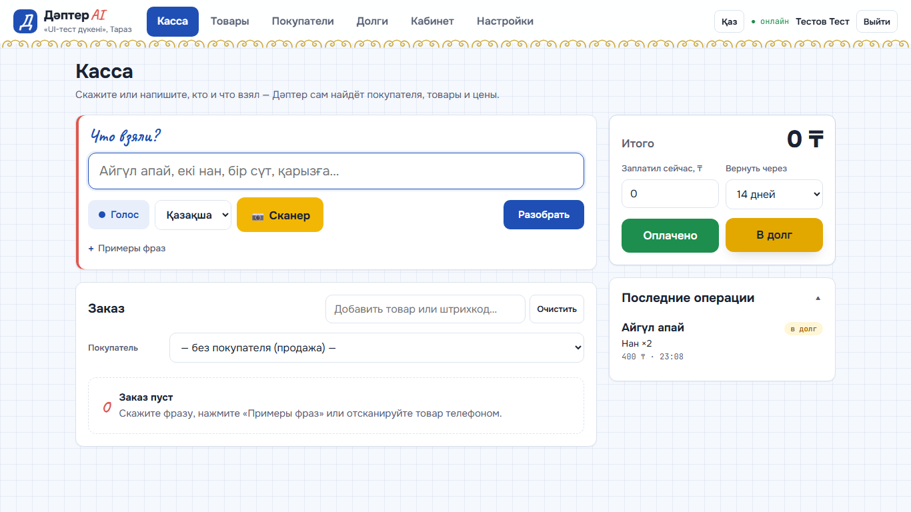
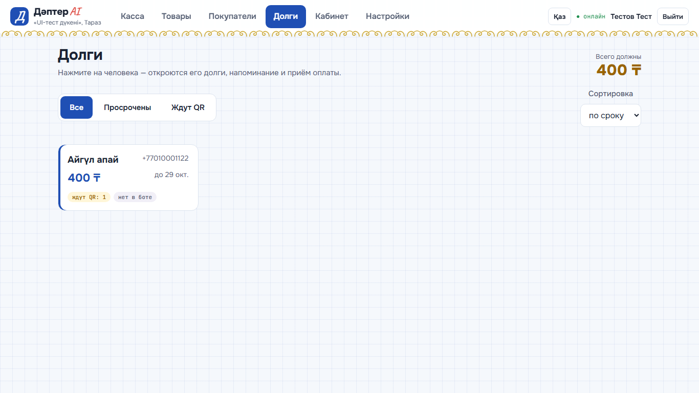
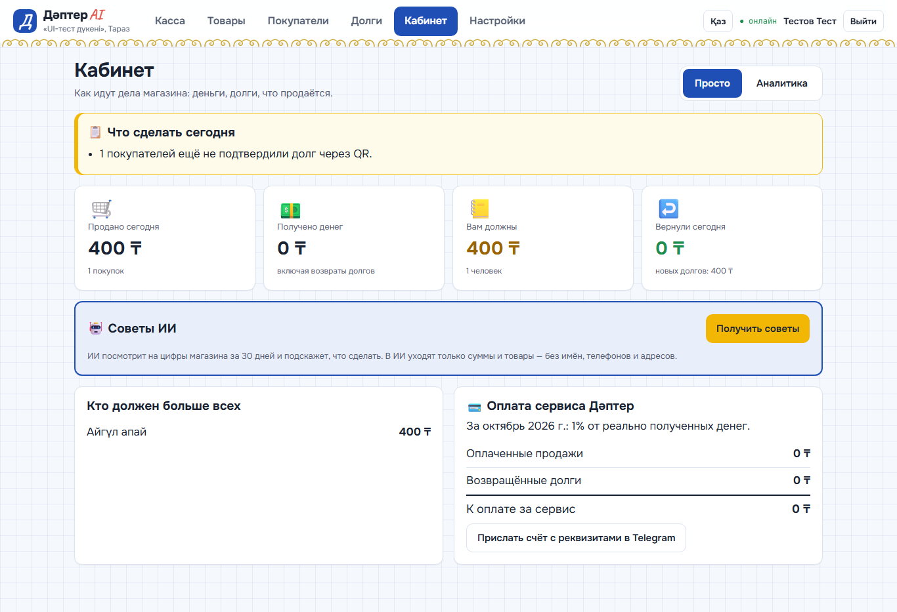

# 📒 Дәптер AI

**Голосовая тетрадь долгов и продаж для магазинов у дома.**
Продавец говорит по-казахски или по-русски: «Айгүл апай, екі нан, бір сүт, қарызға» — Дәптер сам находит покупателя, товары и цены, записывает продажу или долг, а покупатель подтверждает долг в Telegram по QR-коду.



## Какую проблему решает

В небольших магазинах Тараза и области долги покупателей по-прежнему ведут в бумажной тетради «дәптер»:

- записи теряются, суммы спорные — нет подтверждения от покупателя;
- напоминать о долге неловко, и деньги возвращаются медленно;
- владелец не видит, сколько продано за день и кто сколько должен;
- кассовые программы сложные для пожилых продавцов.

Дәптер AI оставляет привычную «тетрадь», но делает её цифровой: говорить можно голосом, всё считается само, а долг подтверждает сам покупатель.

## Возможности

| Раздел | Что умеет |
|---|---|
| **Касса** | Голос или текст на казахском/русском → покупатель, товары, количество и цена; сканер штрихкодов с телефона (повторный скан = +1 шт.); поиск товара по фото через ИИ; оплата сразу или «в долг» со сроком возврата |
| **Долги** | Плитки должников, фильтры «Просрочены / Ждут QR», папки «Ждут подтверждения / Подтверждённые / Возвраты»; QR-согласие покупателя в Telegram; напоминание в Telegram или WhatsApp; приём оплаты (старые долги гасятся первыми) |
| **Товары** | Прайс с синонимами («нан», «хлеб», «батон»); заполнение по фото ценника (ИИ); сканер на телефоне в режиме «в прайс» |
| **Покупатели** | История покупок и возвратов, баланс, язык общения |
| **Кабинет** | «Просто»: что сделать сегодня, главное за день, советы ИИ; «Аналитика»: графики продаж, долгов и топ товаров; оплата сервиса за месяц |
| **Telegram-бот** | Покупатель подтверждает долг кнопкой «Растаймын», получает напоминания и сообщает об оплате; владелец получает уведомления и вечерний отчёт |

Интерфейс на русском и казахском (кнопка «Қаз / Рус»), рассчитан на телефон и ноутбук.



## Где работает ИИ

1. **Разбор фразы.** Сначала быстрые правила (казахские числа словами, «екі нан», упаковки «10 дана», опечатки распознавания речи). Если правила не поняли фразу — подключается Google Gemini.
2. **Фото ценника → карточка товара** (название, цена, синонимы).
3. **Фото товара на кассе → похожие товары из прайса**, продавец подтверждает нужный.
4. **Советы владельцу** по цифрам за 30 дней. В ИИ уходят только суммы и названия товаров — без имён, телефонов и адресов покупателей.

Без ключа ИИ касса продолжает работать на правилах.

## Модель оплаты

По итогам интервью с 2–3 магазинами: процент от реально полученных денег — оплаченных продаж и возвращённых долгов — от 0,5% до 2% в месяц. С покупателей ничего не берётся. Сумма за месяц видна в «Кабинете», счёт с реквизитами Kaspi бот присылает владельцу в Telegram.

## Как устроено

```
Телефон / ноутбук (браузер)  ──HTTPS──▶  Cloudflare Tunnel  ──▶  FastAPI (Python)  ──▶  SQLite
        │  WebSocket: экраны кассы и сканера синхронизируются вживую          │
        │                                                                      ├──▶ Google Gemini (ИИ)
Telegram покупателя и владельца  ◀──────────── python-telegram-bot ◀─────────┘
```

- **Сервер:** Python 3.10+, FastAPI, Uvicorn, SQLite, python-telegram-bot, qrcode.
- **Интерфейс:** HTML, CSS и JavaScript без фреймворков; Chart.js для графиков, html5-qrcode для сканера, Web Speech API для голоса.
- **Аккаунты:** у каждого магазина свои данные; пароли хранятся как PBKDF2-хеш, вход по cookie-сессии.

| Папка | Что внутри |
|---|---|
| `app/` | сервер: API (`main.py`), база (`db.py`), разбор фраз (`parser.py`), ИИ (`ai.py`), бот (`bot.py`), отчёты и аналитика |
| `web/` | страницы и скрипты интерфейса |
| `tools/` | запуск одной кнопкой (`run.py`), запись ключей в `.env` |
| `tests/` | автотесты интерфейса, API, привязки Telegram и проверка через внешнюю ссылку |

## Демо-доступ

| | |
|---|---|
| Email | `demo@daptar.kz` |
| Пароль | `Taraz-Demo-2026` |

На главной и на странице входа есть кнопка **«Посмотреть демо-магазин»** — вход без пароля.
Все данные демо вымышленные. Демо-магазин общий; в «Настройках» его можно вернуть к исходному виду.

## Запуск на Windows

```
python -m venv .venv
.venv\Scripts\python.exe -m pip install -r requirements.txt
copy .env.example .env
```

Затем дважды щёлкните **`Запустить Дәптер.bat`**: поднимется сайт, а в окне появится ссылка и QR-код для телефона и других устройств.
Для этого нужен `tools\cloudflared.exe` с [официальной страницы Cloudflare](https://github.com/cloudflare/cloudflared/releases). Без него сайт открывается только на этом компьютере: http://127.0.0.1:8000.

Необязательно:
- **Telegram-бот:** токен от @BotFather — `.venv\Scripts\python.exe tools\set_secret.py BOT_TOKEN` (берёт токен из буфера обмена, на экран не выводит).
- **ИИ:** ключ из Google AI Studio — `.venv\Scripts\python.exe tools\set_secret.py GEMINI_API_KEY`.

## Тесты

```
.venv\Scripts\python.exe -m pip install playwright
.venv\Scripts\python.exe -m playwright install chromium
.venv\Scripts\python.exe tests\e2e_ui.py
.venv\Scripts\python.exe tests\crash_api.py
.venv\Scripts\python.exe tests\bot_binding.py
.venv\Scripts\python.exe tests\external_check.py https://ваша-ссылка
```

Перед запуском `e2e_ui.py`, `crash_api.py` и `external_check.py` сайт должен быть запущен.

## Ограничения прототипа

- Сайт работает, пока включён компьютер, на котором он запущен.
- Голосовой ввод — в браузере Chrome; качество зависит от шума в магазине.
- Ставку оплаты сервиса пока может менять владелец магазина в «Настройках».

---


